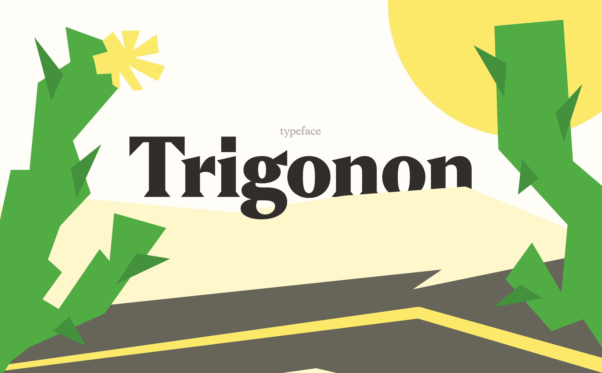

# Trigonon — лонгрид о шрифте

Лонгрид о шрифте Trigonon, его истории, начертаниях и особенностях. В проекте я постарался передать характер шрифта через типографику, иллюстрации и небольшие интерактивные элементы.

## Ссылка на сайт

[Ссылка на GitHub Pages]( https://varlamovsavl.github.io/trigonon-site/ )

## Скриншот

## Автор

Савелий Варламов, БДЗ3266.

## Что я научился делать

- Научился работать с большими текстовыми блоками и выстраивать композицию страницы с помощью CSS.
- Разобрался, как расположить текст вертикально с помощью `writing-mode`.
- Научился использовать JavaScript для масштабирования страницы при изменении ширины окна браузера.
- Разобрался, как создавать простые эффекты при наведении на элементы с помощью CSS.
- Понял, что при верстке сложного макета важно следить не только за отдельными элементами, но и за их расположением относительно друг друга.

## Использование ИИ

### Инструменты

| Инструмент | Для чего использовал | Уровень помощи |
| --- | --- | --- |
| Claude Code | Помог разобраться с масштабированием страницы через JavaScript и настройкой эффектов при наведении на буквы. Также помогал с отдельными моментами в CSS. | 2 |

### Записи о запросах

#### Запись №1 · 23.10.2026

- **Что я хотел сделать:** добиться того, чтобы страница сохраняла пропорции макета и масштабировалась в зависимости от ширины окна браузера.
- **Что я спросил:** «Как сделать масштабирование страницы через JavaScript, чтобы макет шириной 1280 пикселей пропорционально уменьшался или увеличивался при изменении ширины окна?»
- **Что ответил ИИ:** подсказал использовать ширину окна браузера для расчёта масштаба и обновлять его при изменении размера окна.
- **Что я изменил сам:** использовал предложенный подход в своём скрипте и подогнал его под структуру страницы.
- **Как я понял, что это работает:** изменил ширину окна браузера и проверил, как масштабируется страница.

#### Запись №2 · 23.10.2026

- **Что я хотел сделать:** точнее выровнять текст и элементы внутри одного из блоков, чтобы они не смещались относительно друг друга.
- **Что я спросил:** «Как лучше выровнять текст и соседние элементы в CSS, чтобы сохранить нужные расстояния и расположение?»
- **Что ответил ИИ:** подсказал проверить настройки `flexbox`, отступы и выравнивание элементов.
- **Что я изменил сам:** поправил значения отступов и выравнивания под свой макет.
- **Как я понял, что это работает:** проверил блок в браузере и убедился, что элементы стоят на нужных местах.

#### Запись №3 · 23.10.2026

- **Что я хотел сделать:** настроить расстояния между элементами в одном из текстовых блоков, чтобы композиция выглядела аккуратнее.
- **Что я спросил:** «Как в CSS настроить расстояние между элементами, не добавляя лишние отступы каждому из них?»
- **Что ответил ИИ:** объяснил, как использовать `gap` для управления расстояниями между элементами внутри flex- и grid-контейнеров.
- **Что я изменил сам:** попробовал изменить `gap` и выбрал подходящее значение для своего блока.
- **Как я понял, что это работает:** посмотрел на результат в браузере и сравнил расстояния с макетом.

#### Запись №4 · 24.10.2026

- **Что я хотел сделать:** добавить интерактивность в блок с глифами, чтобы буквы меняли начертание и под ними появлялась графическая линия при наведении.
- **Что я спросил:** «Как сделать эффект при наведении на буквы с помощью CSS, чтобы менялась толщина шрифта и плавно появлялась линия под буквой?»
- **Что ответил ИИ:** подсказал использовать `:hover`, `transition` и изменение `font-weight` и `background-size`.
- **Что я изменил сам:** настроил стили под свой макет, подобрал параметры линии и скорость анимации.
- **Как я понял, что это работает:** навёл курсор на разные буквы и проверил, как меняются их начертания и появляется линия.

#### Запись №5 · 24.10.2026

- **Что я хотел сделать:** расположить текст вертикально, как в макете, и сохранить правильное направление букв.
- **Что я спросил:** «Как в CSS сделать вертикальный текст, чтобы он располагался так же, как в макете?»
- **Что ответил ИИ:** объяснил, как работает `writing-mode`, и подсказал, какое значение использовать для вертикального расположения текста.
- **Что я изменил сам:** применил свойство к нужному элементу и подогнал его положение под макет.
- **Как я понял, что это работает:** открыл страницу в браузере и сравнил расположение текста с макетом.

### Выводы

Больше всего ИИ помог с отдельными техническими моментами, особенно с JavaScript и эффектами в CSS. Он позволил быстрее разобраться в некоторых свойствах и найти подходящие способы реализации. Предложенные решения пришлось подгонять под мой макет, потому что не все параметры подходили с первого раза. В итоге я лучше понял, как работает масштабирование страницы и как создавать простые интерактивные эффекты без дополнительных библиотек.